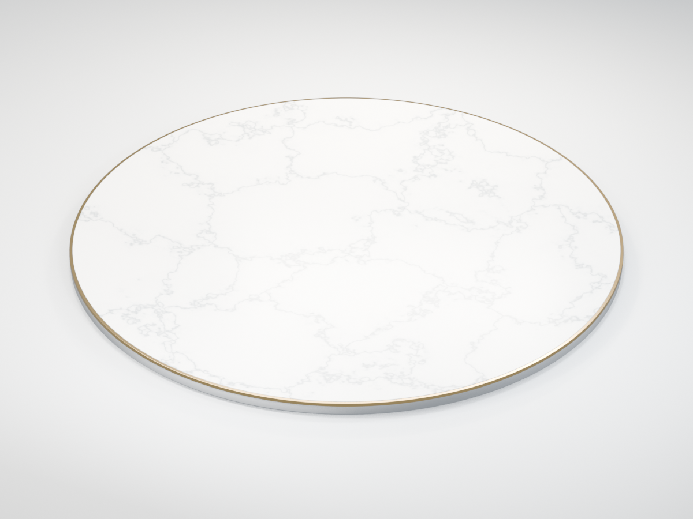
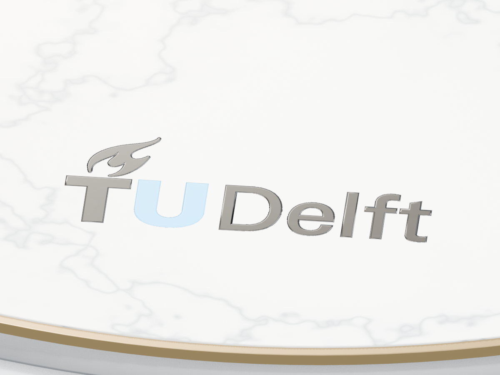
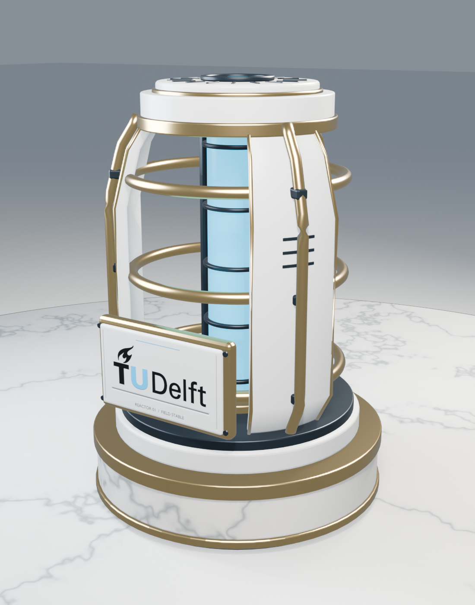
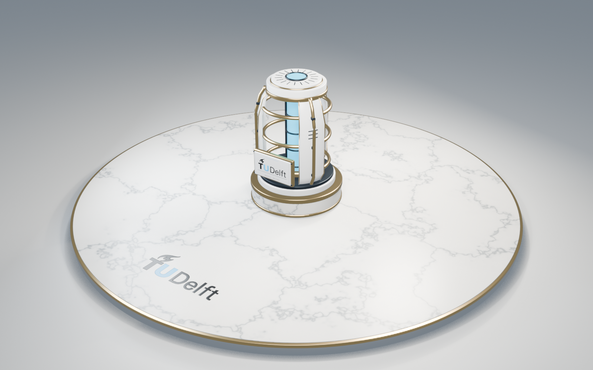
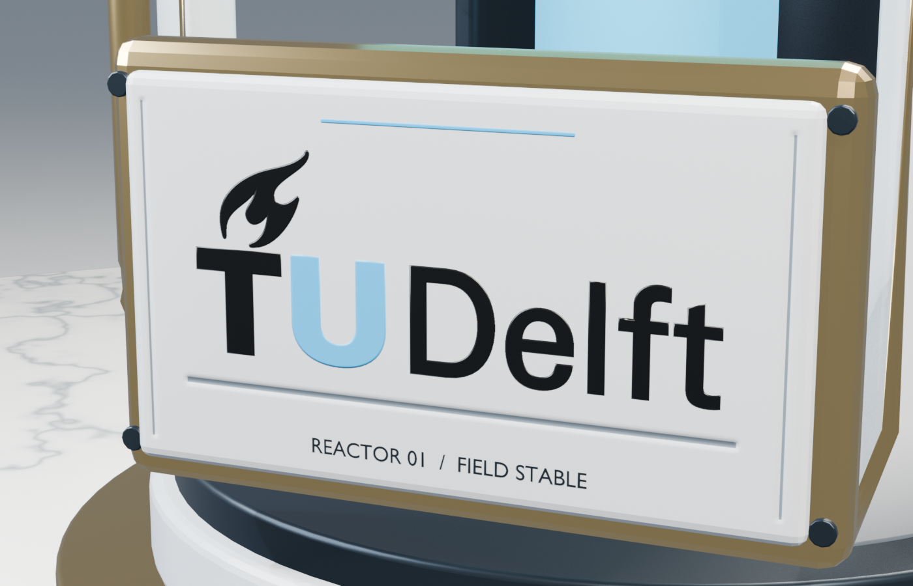
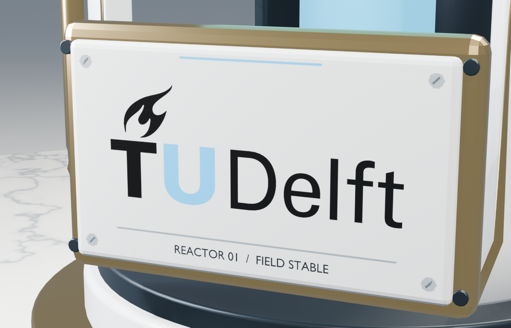
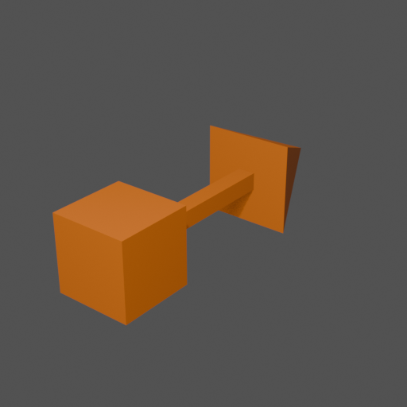

# Scene assets

## Environment

| File | Purpose |
| --- | --- |
| `environment/qwantani_noon_puresky_2k.hdr` | 2048 × 1024 linear HDR equirectangular panorama; source for the sky background and PBR environment reflections. |

**Qwantani Noon (Pure Sky)** is from [Poly Haven](https://polyhaven.com/a/qwantani_noon_puresky),
photographed by **Greg Zaal** and processed by **Jarod Guest**. It is distributed
under [CC0](https://polyhaven.com/license). The downloaded 2k Radiance HDR file is
unmodified (MD5 `a316dccf04a17de5581240ed172790f0`, 4,184,949 bytes).

The application converts the panorama into a floating-point cubemap at startup,
then generates mipmaps for an approximate roughness-dependent reflection blur.
It uses 32-bit float RGB to preserve sun values beyond the half-float range.
The cubemap is generated data, not another committed asset. Reflections use only
this distant environment; scene objects are not captured into it. To try a
cloudier alternative, keep Poly Haven's `sunflowers_puresky` in mind; it is not
bundled with the project.

## Platform



A 12 m diameter, 0.38 m tall circular exhibit platform with a polished white
marble top, narrow gold rim, and beveled satin-white base. An original-color
TU Delft logo near the front edge provides an orientation marker and a clearly
visible normal-mapping example. The shared origin is at ground level in the
center. The application loads its three material groups and base-color texture
alongside the reactor, using directional and spotlight lighting with adjustable
ambient fill and PBR environment reflections. The previews below are Blender
renders of the full authored materials.

### Files

| File | Purpose |
| --- | --- |
| `source/platform.blend` | Editable platform geometry, UVs, materials, hidden logo-baking sources, and a preview studio with overview/detail cameras. |
| `source/TU_Delft_Logo.svg` | User-provided original vector logo, retaining its black and blue colors. |
| `models/platform.obj` | Triangulated platform export: 15,352 triangles, three material groups, UVs, and normals. |
| `models/platform.mtl` | Exported material properties and relative texture references. |
| `textures/marble_basecolor.png` | Reusable 2048 × 2048 marble-only base color, interpreted as sRGB; source for the platform composition and other marble assets. |
| `textures/marble_roughness.png` | 2048 × 2048 roughness texture, interpreted as linear/non-color data. |
| `textures/platform_basecolor.png` | 4096 × 4096 marble and positioned logo composition, interpreted as sRGB. |
| `textures/platform_normal.png` | 4096 × 4096 tangent-space logo relief, interpreted as linear/non-color data; flat normals elsewhere. |
| `previews/platform.png` | Rendered preview for reviewing the asset. |
| `previews/platform_logo_normal_on.png` | Logo close-up with normal-map strength 1.25. |
| `previews/platform_logo_normal_off.png` | Matching close-up with strength 0; camera, color, lighting, and exposure are unchanged. |

### Materials

The application retains the OBJ's material names and reads their colors,
metallic/roughness constants, and base-color/roughness/normal image references
from the MTL. Roughness and normal images are uploaded as linear/non-color
textures. Missing `Pm`
and `Pr` use tinyobjloader's existing default of 0, including the omitted `Pr`
for textured marble; `platform_marble` has no `Kd` either (Blender omits
constants for connected texture inputs) and imports the gray (0.6, 0.6, 0.6)
fallback after our vendored-copy bugfix. Under PBR shading with material
textures enabled, the roughness image supplies marble's variation. The table
below describes the full authored materials that the PBR renderer uses. Constant
RGB values are linear shader values. All three materials have zero emission.

| Material name | Base color | Metallic | Roughness | Normal mapping |
| --- | --- | --- | --- | --- |
| `platform_marble` | `textures/platform_basecolor.png` | 0 | `textures/marble_roughness.png`; authored in the 0.22–0.30 range. | `textures/platform_normal.png`, strength 1.25. |
| `gold` | `(0.83, 0.57, 0.23)` | 1 | 0.21 | Geometric normals. |
| `platform_base` | `(0.73, 0.75, 0.77)` | 0 | 0.34 | Geometric normals. |

UV coordinates cover a 12 m texture span, with a planar mapping on the top and
cylindrical mapping on the thin side. The Blender preview material uses the same
exported PNGs intended for the application. The reusable marble-only material
`marble` and its textures remain available separately from `platform_marble`.

Blender exports the RGB normal map reference as
`map_Bump -bm 1.250000 ../textures/platform_normal.png` in the MTL. For this asset,
interpret that image as a **tangent-space normal map**, not a grayscale height
map. Its channel convention is +X, +Y, +Z (OpenGL-style), and its normal-map
strength is 1.25. The application generates the tangent basis from the mesh
positions/UVs at load time and reads the strength from the exported `-bm`
value.

### Logo placement and normal-map demonstration

- The artwork is approximately 2.2 m wide, centered at Blender `(0, -4.4, 0.38)`
  on the marble top, leaving roughly 1 m to the rim. Its baseline runs along X,
  and it reads upright when viewed from the front.
- The designated front is Blender **−Y**, corresponding to application **+Z**
  after the Y-up OBJ export. The logo stays fixed to the platform's local axes.
- The detailed baking source rises approximately 2.6 cm above the slab, with
  1 cm bevels. The baked effect is deliberately exaggerated for demonstration.
- The runtime platform still has three mesh parts and 15,352 triangles. The logo
  relief is entirely in the normal texture; it adds no runtime logo geometry.
- In Blender's `platform_marble` material, locate the Normal Map node labeled
  **Logo emboss**. Set Strength to **0** for flat artwork and **1.25** for raised
  shading. The normal map changes highlights along the bevels while preserving
  the color image and mesh silhouette.

| Normal mapping on | Normal mapping off |
| --- | --- |
|  |  |

### Editing and exporting

- The **`Platform | EXPORT`** collection contains the three asset meshes. Each
  shares the ground-center origin and has identity object transforms.
- The **`Studio | PREVIEW ONLY`** collection contains the camera, softbox lights,
  and floor used for the preview, plus a logo detail camera. These are excluded
  from the OBJ export.
- The **`Platform Logo | BAKE SOURCES`** collection is hidden in the viewport and
  renders. It retains the editable SVG curves with extrusion/bevel settings and
  a flat marble backing plane for rebaking. These are excluded from the export.
- The Blender source uses meters with **Z up**. The OBJ is exported with **Y up**
  and **−Z forward**, at scale 1, for the application's coordinate convention.
- Select the three meshes in the export collection and export selected objects,
  with modifiers applied, triangulation, normals, UVs, materials, and relative
  texture paths. Keep the editable bevel modifiers in the Blender source.
- The unused-but-preserved **`marble_procedural`** material is the editable source
  graph for rebaking the marble. The reusable **`marble`** material uses the baked
  marble-only images. Bake color without lighting/shadows and roughness as
  non-color data over a plane with UVs spanning `(0, 0)` to `(1, 1)`.
- For the platform logo textures, evaluate the raised SVG curves to temporary
  meshes and bake them together with the marble backing onto a flat 12 × 12 m
  target plane at slab-top height, with UVs spanning `(0, 0)` to `(1, 1)`. Use
  selected-to-active baking with 0.10 m cage extrusion and 0.20 m maximum ray
  distance. Bake diffuse color with only the Color pass, then tangent-space
  normals with +X/+Y/+Z channels. Keep the high-detail sources out of the export.

### Authorship and verification

Geometry and marble textures were created specifically for this project in
Blender. The marble was authored procedurally and baked to PNGs. The TU Delft logo
artwork is from the user-provided `source/TU_Delft_Logo.svg`, credited to TU Delft;
its beveled relief and platform texture composition were created for the
project. The preview uses Blender area lights and a uniform world environment.

The evaluated source meshes were checked for closed/manifold geometry. The OBJ
was re-imported in Blender to check geometry, UVs, and its three material groups;
the MTL's texture references were also checked. The overview and matched logo
close-ups show the baked textures, rather than the high-detail source geometry.

## Reactor

| Reactor detail | On the platform |
| --- | --- |
|  |  |

A 3.5 m tall static reactor with a 2.49 m diameter footprint: a marble pedestal,
gold collar, three curved ceramic housings, three gold structural supports,
three gold field rings, a dark inner recess, and an emissive cyan energy column.
The crown has radial cooling vents and a luminous upper aperture. A front-facing
ceramic identity panel carries the original-color TU Delft logo, the caption
**REACTOR 1337 / GROUP 4**, a recessed identity well, a broad lower channel, and four baked
countersunk fastener details. Wider ceramic bevels around the logo make the
normal-map demonstration clearly visible, including around the dark lettering.

The application loads the reactor as a separate model instance, translated by
`(0, 0.38, 0)` to sit on the platform. It displays the base colors/textures and
core emission, with camera presets for the complete assembly, reactor, panel,
and platform logo. Blender previews include the full PBR materials, emission,
and a restrained compositor glow; application-side bloom is a planned rendering
stage.

### Files

| File | Purpose |
| --- | --- |
| `source/reactor.blend` | Editable reactor parts and bevel modifiers, hidden panel-baking sources, platform reference, preview lighting, and three cameras. |
| `models/reactor.obj` / `models/reactor.mtl` | Triangulated static assembly: 61,820 triangles, six material groups, UVs, and preserved corner normals. |
| `textures/reactor_panel_basecolor.png` | 2048 × 2048 sRGB panel composition: ceramic background, original logo ink on the letter faces, caption, and flat fastener/channel markings, without baked lighting. |
| `textures/reactor_panel_normal.png` | 2048 × 2048 linear/non-color tangent-space relief for the broad logo bevels, recessed well, caption, channel, and countersunk fasteners. |
| `previews/reactor.png` | Hero render of the reactor. |
| `previews/reactor_on_platform.png` | Full platform composition showing the relative scale. |
| `previews/reactor_panel_normal_on.png` / `previews/reactor_panel_normal_off.png` | Matching panel close-ups with normal-map strength 1.5 and 0, under identical lighting including a side/raking inspection light. |

The pedestal reuses `marble_basecolor.png` and `marble_roughness.png` at the
platform's 12 m texture span. The logo source is the existing user-provided
`source/TU_Delft_Logo.svg`.

### Materials

All constant RGB values are linear. Materials other than `cyan_core` have zero
emission. The material names and image references are exported in the MTL;
assign materials by name rather than by mesh order.

| Material | Base color | Metallic | Roughness | Normal mapping |
| --- | --- | --- | --- | --- |
| `marble` | Shared `marble_basecolor.png` | 0 | Shared `marble_roughness.png` | Geometric normals. |
| `gold` | `(0.83, 0.57, 0.23)` | 1 | 0.21 | Geometric normals. |
| `ceramic` | `(0.78, 0.81, 0.84)` | 0 | 0.25 | Geometric normals. |
| `graphite` | `(0.018, 0.028, 0.040)` | 0.65 | 0.30 | Geometric normals. |
| `cyan_core` | `(0.008, 0.32, 0.48)` | 0 | 0.22 | Geometric normals. |
| `reactor_panel` | `reactor_panel_basecolor.png` | 0 | 0.24 | `reactor_panel_normal.png`, strength 1.5. |

The core's Blender emission color is `(0, 0.25, 0.45)` with strength 4, exported
as `Ke 0 1 1.8`. The application reads this linear emission value directly and
adds it in Lit mode when the **Emission** checkbox is enabled. HDR rendering and
bloom will provide the surrounding halo in a later rendering stage.

As with the platform, the panel's MTL reference is
`map_Bump -bm 1.500000 ../textures/reactor_panel_normal.png`. Interpret this as a
**tangent-space normal map**, with OpenGL-style +X, +Y, +Z channels, rather than
a grayscale height image. The panel front uses U along Blender +X and V along
Blender +Z. The application loads it with the strength 1.5 read from `-bm` and
generates the tangents from the mesh positions/UVs.

| Normal mapping on | Normal mapping off |
| --- | --- |
|  |  |

### Scene organization and placement

- **`Reactor | EXPORT`** contains 77 editable mesh parts. Their object transforms
  are identity, and their shared bottom-center origin is `(0, 0, 0)`. The prepared
  OBJ consolidates their evaluated triangles into six material groups.
- **`Reference | Platform`** contains a preview-only import of `platform.obj`,
  lowered by 0.38 m so its top is at Blender Z = 0. It is excluded from the reactor
  export.
- **`Studio | PREVIEW ONLY`** contains the floor, three softboxes, a small cyan
  spill light, a side/raking panel-inspection light, and hero, panel-detail, and
  platform-overview cameras. These are excluded from the export. The compositor
  glow is preview-only too. The saved scene opens in the panel-detail camera.
- **`Reactor Panel | BAKE SOURCES`** is hidden in the viewport and renders. It
  preserves the editable SVG curves, caption, recessed backing surface, evaluated
  source meshes, and planar UV receiver for rebaking. These are excluded from
  the export.
- The source uses meters with **Z up**, and its designated front is **−Y**. The
  OBJ uses **Y up** and **−Z forward**, so the front becomes application **+Z**.
  Place the reactor on the existing platform with a model translation of
  **`(0, 0.38, 0)`** in application coordinates.

### Baking and verification

The panel's logo source reaches approximately 2.45 cm above the receiver and has
7.5 mm bevels. The flat upper faces retain the original logo ink; the sloped
surrounds use ceramic so their shading remains readable around black lettering.
The backing has a 12 mm recessed identity well with 18 mm bevel transitions, a
9 mm lower channel, and four 11 mm countersinks containing slotted fastener
heads. All of this panel-face relief is stored in the normal texture: the broad
runtime front face is flat, with no separate lettering or added fastener meshes.
The frame's corner fasteners are separate geometry.

Both panel images were baked selected-to-active at 2048 × 2048 with 0.06 m cage
extrusion, 0.12 m maximum ray distance, and a 12-pixel margin. Color uses the
diffuse color pass without direct or indirect lighting, so highlights and shadows
are not painted into the base-color map. Normals use tangent space with +X, +Y,
+Z channels. The normal-on/off previews differ only in the normal-map strength;
the camera, lighting, base-color texture, and runtime geometry are identical.

All 77 evaluated reactor source meshes were checked for closed/manifold geometry.
The OBJ was re-imported to check its 61,820 triangles, six material assignments,
UVs, custom normals, and 2.49 × 2.49 × 3.5 m bounds. The panel comparison renders
use the exported PNGs with identical camera and lighting. The model and textures
were created for this project in Blender; the logo artwork is credited to TU Delft
and comes from the user-provided SVG.

## Drone

A static drone assembly supplied through the partner's `drone` branch and
[PR #1](https://github.com/rej100/cg-project/pull/1): a textured body and four
separately exported propellers. The application loads all five models through
the OBJ/MTL pipeline and creates one scene object for each part.

### Files

| File | Purpose |
| --- | --- |
| `models/drone_body.obj` / `models/drone_body.mtl` | Body, including chassis, camera, wing-part, and battery material groups. |
| `models/L_F_propeller.obj` / `models/L_F_propeller.mtl` | Left-front propeller. |
| `models/R_F_propeller.obj` / `models/R_F_propeller.mtl` | Right-front propeller. |
| `models/L_B_propeller.obj` / `models/L_B_propeller.mtl` | Left-back propeller. |
| `models/R_B_propeller.obj` / `models/R_B_propeller.mtl` | Right-back propeller. |
| `textures/drone_chasis.png` | Body chassis base color; filename retained from the contribution. |
| `textures/drone_cam.png` | Camera base color. |
| `textures/wing_parts.png` | Wing-part base color. |
| `textures/drone_battery.png` | Battery base color. |
| `textures/drone_motor.png` | Propeller/motor base color. |

The material files reference the PNGs through relative `../textures/` paths.
Base-color images are interpreted as sRGB by the application. All supplied
drone materials have zero emission. Their MTLs omit `Pm` and `Pr`, so the
application imports metallic 0 and roughness 0 using tinyobjloader's defaults.

### Placement and part transforms

The body uses the contributed root transform:

```text
root = translation(0, 4.38, 4) * scale(4)
propeller = root * translation(local offset)
```

The root height is `PLATFORM_HEIGHT + 4.0`, and the uniform scale is applied
to both the component geometry and these model-local offsets:

| Part | Local offset `(X, Y, Z)` |
| --- | --- |
| Left front | `(-0.1074, -0.0204, -0.0957)` |
| Right front | `(0.1072, -0.0204, -0.0957)` |
| Left back | `(-0.1074, -0.0204, 0.0915)` |
| Right back | `(0.1072, -0.0204, 0.0915)` |

This assembly provides the starting placement for the planned flight-path
and component animation stages.

## Spotlight placeholder



A small orange box and arrow used to show the spotlight's position and aim.
The 0.30 m box is centered at the shared origin, and the arrow tip is 1.10 m
from that origin. It has 30 triangles and one constant-color material,
`spotlight_marker`, with linear base color `(1, 0.24, 0.015)` and zero emission.
It was authored for this project in Blender and uses no textures.

### Files

| File | Purpose |
| --- | --- |
| `source/placeholder.blend` | Editable box, shaft, and arrowhead in one mesh, with a preview camera and softbox. |
| `models/placeholder.obj` / `models/placeholder.mtl` | Triangulated marker with flat normals, one material group, and no UV references. |
| `previews/placeholder.png` | 512 × 512 Blender preview. |

### Coordinates and application use

- The origin is the **box center**, representing the light source position.
- The source uses meters with **Z up**; the arrow points along Blender **+Y**.
- Export selected geometry with **Y up**, **−Z forward**, scale 1,
  triangulation, normals, and materials. The exported arrow therefore points
  along application **−Z**, with its tip at `(0, 0, -1.10)`.
- The exported bounds are X/Y `[-0.18, 0.18]` and Z `[-1.10, 0.15]`, giving
  dimensions **0.36 × 0.36 × 1.25 m**.
- **`Placeholder | EXPORT`** contains the asset mesh; **`Studio | PREVIEW ONLY`**
  contains the camera and softbox, excluded from the OBJ export. The source
  opens with the marker selected and framed in a material-colored solid view.
- The application loads the OBJ at its authored scale, derives the marker's
  transform from the spotlight position/target, and draws it using Base color
  shading. The **Show light marker** checkbox controls its visibility.

The three component surfaces are closed, with no boundary or non-manifold
edges. Exported geometry, material color, triangle count, and arrow-axis
convention were checked against the application's original marker.
